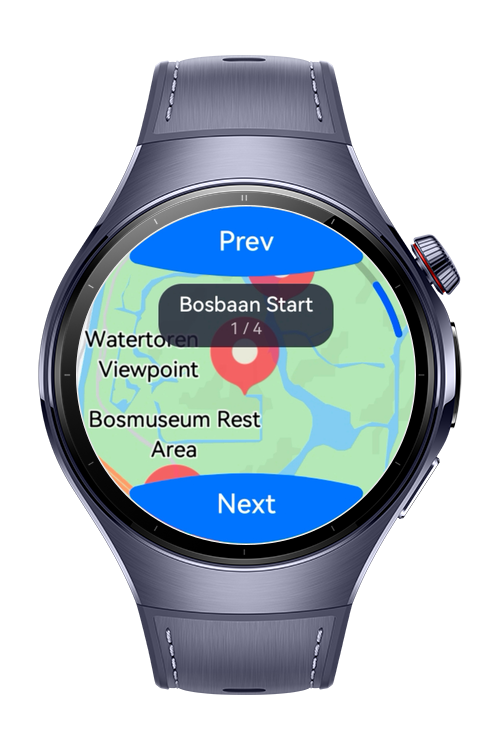
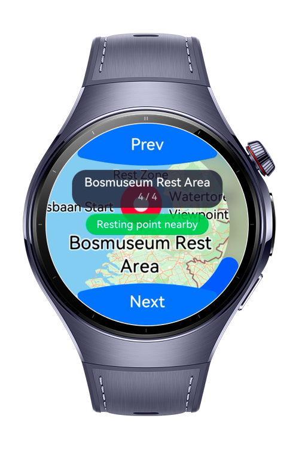
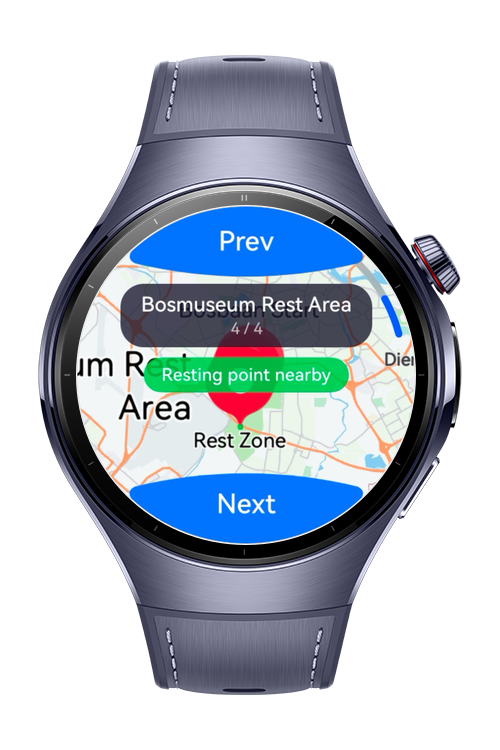
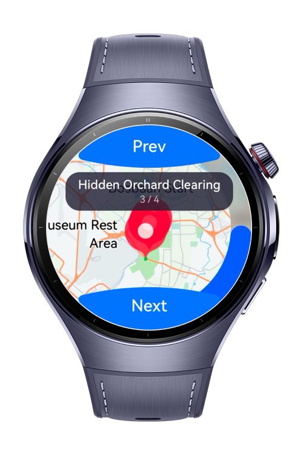

> **Note:** To access all shared projects, get information about environment setup, and view other guides, please visit [Explore-In-HMOS Index](https://github.com/Explore-In-HMOS/hmos-index).

# How to Build Map Overlay Config

This codelab demonstrates how to configure and animate map overlays on HarmonyOS NEXT wearable Watch 5 devices using **MapKit**. The app displays a short hiking trail through Amsterdamse Bos with four `PointAnnotation` waypoints, simulates a hiker's progress via Next / Previous `ArcButton` controls, and uses `SpatialRelationUtil` to detect when the simulated position enters a rest-zone polygon triggering a proximity alert. No real GPS or location permissions are required.

# Preview

<div>
  
  
  
  
</div>

# Use Cases

- **BaseOverlay — tag-based marker identification** — every `PointAnnotation` is tagged with a unique waypoint ID via `setTag()` on creation; a `pointAnnotationClick` listener retrieves it with `getTag()` to re-select the tapped waypoint without holding direct object references.
- **BaseOverlay — visibility and z-ordering** — `setZIndex()` promotes the active waypoint marker to the top layer and demotes the previous one on each step; `setVisible()` shows and hides the rest-zone alert overlay on the map in response to the proximity check.
- **BasePriorityOverlay — collision priority** — `setPriority()` is set per waypoint so the active label always wins screen space when markers overlap at the default zoom level.
- **BasePriorityOverlay — zoom-range gating** — the "Hidden Orchard Clearing" waypoint (category `HIDDEN_GEM`) is restricted to zoom levels 16–20 via `setZoom()`, hiding it on the wide view and revealing it only when the user zooms in close.
- **BasePriorityOverlay — idle pulse animation** — `setAnimation(AlphaAnimation)` is applied to every marker with `AnimationFillMode.BACKWARDS` and `AnimationRepeatMode.RESTART`, producing a continuous soft-fade pulse that loops indefinitely (`repeatCount: -1`).
- **FontSizeAnimation — active-waypoint label emphasis** — when a waypoint is selected, `setTitleAnimation(FontSizeAnimation)` + `startTitleAnimation()` grows the marker's title text from 15 sp to 26 sp, then eases it back automatically using `AnimationRepeatMode.REVERSE`.
- **SpatialRelationUtil — rest-zone proximity detection** — on every waypoint step, `SpatialRelationUtil.isPointContainedInPolygon()` checks whether the simulated hiker position is inside the rest-zone polygon drawn on the map; the result toggles an on-screen banner and a dedicated map overlay.

# Tech Stack

- **Language**: ArkTS
- **UI Framework**: ArkUI (Stage Model)
- **Tools**: DevEco Studio 5.1.0 or later
- **Libraries & Kits**:
    - `@kit.MapKit` — `MapComponent`, `PointAnnotation`, `MapPolygon`, `AlphaAnimation`, `FontSizeAnimation`, `SpatialRelationUtil`, `AnimationFillMode`, `AnimationRepeatMode`
    - `@kit.ArkUI` — `ArcButton`, `ArcButtonOptions`, `ArcButtonPosition`, `ArcButtonStyleMode`
    - `@kit.BasicServicesKit` — `AsyncCallback` for the map initialization callback
    - `@kit.PerformanceAnalysisKit` — `hilog` for structured error logging
    - `@kit.AbilityKit` — `UIAbility`, `AbilityConstant`, `Want`

# Directory Structure

```
how-to-build-map-overlay-config/
├── AppScope/
│   ├── app.json5                            # Bundle name, version
│   └── resources/base/element/
│       └── string.json                      # App label
└── entry/src/main/
    ├── module.json5                          # deviceTypes: ["wearable"], ability declaration
    ├── ets/
    │   ├── entryability/
    │   │   └── EntryAbility.ets              # UIAbility entry point
    │   ├── pages/
    │   │   └── Index.ets                     # MapComponent, overlay setup, animations, ArcButtons
    │   ├── model/
    │   │   └── WaypointData.ets              # 4 mock waypoints + rest-zone polygon (Amsterdamse Bos)
    │   └── constants/
    │       └── Constants.ets                 # Zoom levels, animation timings, z-indices, polygon colors
    └── resources/base/
        ├── element/
        │   ├── color.json                    # All color tokens (chip, alert, background)
        │   ├── float.json                    # All dimension tokens (font sizes, padding, radii, margins)
        │   └── string.json                   # All UI strings (button labels, alert text, ability label)
        └── profile/
            └── main_pages.json5              # Page routing
```

# Constraints and Restrictions

## Supported Device
-  Huawei Watch 5

### Map Kit Setup Required
Map Kit must be enabled in AppGallery Connect **before** generating the signing profile used to install the app. In DevEco Studio: **File → Project Structure → Signing Configs → Enable open capabilities → Map Kit → Apply**. A debug certificate and profile requested *after* enabling Map Kit are required; the app will fail to display the map if signed with a profile predating the capability grant.

### Minimum API Version

| API / Class | Min version |
|---|---|
| `BaseOverlay`, `BasePriorityOverlay`, `AlphaAnimation`, `FontSizeAnimation`, `AnimationFillMode`, `AnimationRepeatMode` | 4.1.0 (11) |
| `SpatialRelationUtil.isPointContainedInPolygon()` | 5.0.0 (12) |
| `MapEventManager` | 5.0.0 (12) |

The codelab targets **API 12** as the minimum.

# License

**How to Build Map Overlay Config** is distributed under the terms of the MIT License.
See the [LICENSE](./LICENSE) for more information.